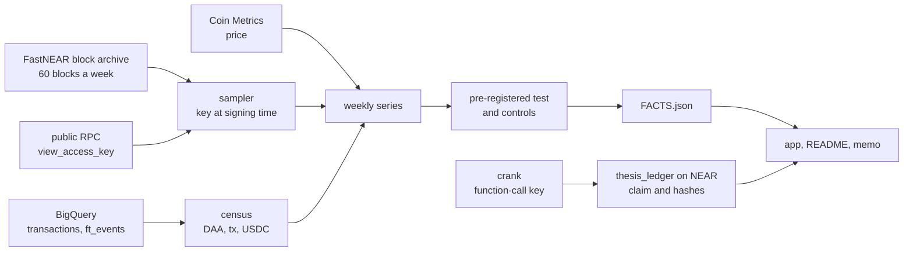

<!-- Generated from docs/README.template.md by scripts/readme.ts. Edit the template. -->
<div align="center">


# Keytell

**On NEAR, do transactions signed by function-call keys show real usage before daily active accounts or price do?**

Pre-registered on NEAR before the test data existed. Rebuild every number with one command.

[Live app](https://keytell.vercel.app) · [Evidence](https://keytell.vercel.app/evidence) · [Against](https://keytell.vercel.app/against) · [Ledger](https://keytell.vercel.app/ledger) · [Proof](https://keytell.vercel.app/proof) · Video: link at submission

[](https://github.com/0xkinno/keytell/actions/workflows/ci.yml) [](https://github.com/0xkinno/keytell/actions/workflows/live.yml) [](LICENSE)


</div>

## The verdict first

**The data did not support the claim.** The data did not support the claim: over 94 out-of-sample weeks of one-step forecasts of weekly USDC volume, adding function-call-signed activity to an AR(2) baseline added 5.1 percent to forecast error; daily active accounts added 3.6 percent to forecast error; price added 5.5 percent to forecast error. The pass rule needs function-call activity to do better than both.

Versus DAA the mean squared-error difference is 0.006578 (95 percent interval -0.055139 to 0.069399); versus price -0.001606 (-0.060525 to 0.05815). Negative favours function-call keys; the pass rule needs both intervals below zero.

The forward claim on chain is **Open**: twelve weeks from 2026-11-16, resolved by anyone after the window, by the contract, from posted weeks.

## At a glance

| | |
|---|---|
| For | A research analyst who must tell an investment committee whether NEAR usage is real or bots and farmers (Tolu Adeyemi, fictional) |
| What it does | Classifies the key that signed each sampled mainnet transaction, tests whether function-call-signed activity forecasts USDC volume better than DAA or price, publishes the case against with the same weight, and exports a memo the analyst signs |
| Why NEAR | Only NEAR has protocol-level function-call keys: a key bound to one contract that cannot attach NEAR. Which kind of key signed is public state, per transaction |
| Verdict (backtest) | The data did not support the claim, over 94 out-of-sample weeks |
| Forward claim on chain | `keytell-fc-leads-usdc-1` on `ledger.keytell.testnet`, Open, 12 weeks from 2026-11-16 |
| Function-call share, latest week | 29.5% in 2026-W45 (interval 23.6% to 36.2%) |
| Track | 02 Investment Thesis |
| Built with | near-sdk 5.29, near-workspaces, cargo-near reproducible build, NEP-297, NEP-330, NEP-366, NEP-413, near-connect, BigQuery `crypto_near_mainnet_us`, FastNEAR, Next.js 16, d3 |

## See it on chain

| What | Where |
|---|---|
| The claim registered, before any out-of-sample query | [FpHj8UhHEyVQBWha...](https://testnet.nearblocks.io/txns/FpHj8UhHEyVQBWhafiY4pQH3UzQpPf2wKXvDFVhTYZQo) at 2026-11-13T18:17:43.113Z; first out-of-sample query 2026-11-13T18:18:03+00:00 |
| Ledger deployed and initialised in one transaction | [3QVVUPwsFNtstbin...](https://testnet.nearblocks.io/txns/3QVVUPwsFNtstbinBre7H6T2B4tTqim2v2AB4LMC4FKR) |
| Ledger sealed: its only key deleted | [CaKuchaw3kXmFqJA...](https://testnet.nearblocks.io/txns/CaKuchaw3kXmFqJAbw5v9c9XMEyUfnmpv9AFH4UtzQP4); access keys now 0 |
| The crank's post-only function-call key added | [3Wg1AM9h41obf3Uo...](https://testnet.nearblocks.io/txns/3Wg1AM9h41obf3UoXdRGQzBjPxUGDJ1Ndm5ghVRyBjmv) |
| A refusal (break campaign) | see `data/break.json`: 16 attempts, all behaved as designed: yes |
| Resolve | opens after the forward window ends; `/ledger` counts down |

## Monday 07:40

Tolu Adeyemi (fictional), research analyst at a crypto fund in Lagos, has twenty minutes before the
investment committee. The partner asks: "Is anyone actually using NEAR, or is it bots and airdrop
farmers?" Every dashboard Tolu can open shows daily active accounts and price. Both are cheap to
fake. Today Tolu screenshots a DAA chart and says "activity is up"; the committee sizes the position
on conviction.

| What is true | Source |
|---|---|
| NEAR records which kind of key signed every transaction | [docs.near.org, access keys](https://docs.near.org/protocol/accounts-contracts/access-keys) |
| "`Function Call Keys` are meant to be shared with applications" | same page |
| Function-call keys "do not allow to attach NEAR tokens to the call" | same page |

With Keytell, Tolu opens one page: the claim fixed on chain first, the evidence for, the evidence
against, the SQL behind every chart, a lookup that classifies any account, and a memo to sign.
Tolu decides; Keytell never says buy. The NEP-413 signature on the memo is Tolu's attestation that
the evidence against was read.

## The claim

> On NEAR, the volume of transactions signed by function-call keys is a better leading indicator of real application usage than daily active accounts or token price.

Registered at 2026-11-13T18:17:43.113Z in `ledger.keytell.testnet`. Method hash `90f687b9d36d7ef6...` ([docs/METHOD.md](docs/METHOD.md)); code manifest hash `47e2d8be113495fc...` ([docs/CODE_MANIFEST.sha256](docs/CODE_MANIFEST.sha256)); data commit `e27a50818aa1c2e9`. Both hashes match the repository: method yes, manifest yes.

## The evidence for

- The data did not support the claim: over 94 out-of-sample weeks of one-step forecasts of weekly USDC volume, adding function-call-signed activity to an AR(2) baseline added 5.1 percent to forecast error; daily active accounts added 3.6 percent to forecast error; price added 5.5 percent to forecast error. The pass rule needs function-call activity to do better than both.
- In 2026-W45, 29.5 percent of sampled mainnet transactions were signed by a function-call key (95 percent interval 23.6 percent to 36.2 percent); 35.5 percent were meta transactions relayed for a user.
- The sample's weekly transaction estimate lands within 7.8 percent of the BigQuery census in the median week.
- Best in-sample lags: function-call-signed 4 weeks, DAA 4, price 3.

## The evidence against

We lead with it as hard as with the case for.

- The real out-of-sample gain (-5.1 percent) beats 9 percent of 1000 timing placebos; the bar is 95 percent.
- The ten contracts that function-call keys were most often scoped to carry 91.4 percent of all sampled function-call transactions.
- Function-call keys flagged 28 weeks: 13 hits and 15 false alarms, with 24 misses. DAA: 2 hits, 7 false alarms, 35 misses.
- Control reruns (concentration, relayers, unknown keys, episodes): see [/against](https://keytell.vercel.app/against) and `data/out/controls.json`. 1 of 8 control reruns would pass the registered rule: every relayed meta transaction counted as function-call activity. It was registered as a control, not as the claim, so it does not change the verdict; docs/FINDINGS.md treats it as a hypothesis for a new pre-registration.
- Largest weekly share of keys nobody could read: 1.5%. Weeks above 5 percent in the scored window: none.

## What would change this conclusion

- The forward claim succeeding on chain: at least half of the 12 forward weeks won. That is new evidence, not a rerun of old weeks.
- A new claim, registered before its data, that holds out of sample. A control picked after the fact does not count.
- The USDC census proving wrong or incomplete in a way that changes the out-of-sample errors.

## How it works



1. `scripts/sample-chain.ts` draws 60 seeded random blocks per ISO week, then 200 seeded random transactions, and classifies each signing key at signing time over public RPC (now, or at the block before signing on archival RPC).
2. `sql/04` and `sql/05` count transactions, daily active accounts and USDC transfers on BigQuery.
3. `analysis/method.py` chooses each signal's lag on the in-sample window, then scores expanding-window one-step forecasts out of sample. `analysis/controls.py` reruns it under every control.
4. `scripts/facts.ts` writes `docs/FACTS.json`; the app, this README and the memo read only from it.
5. `contracts/thesis_ledger` holds the claim. No edit or upgrade method, zero keys. The crank posts each forward week with a key limited to `post`.

## Why only NEAR

- **Access key types.** A function-call key is bound to one receiver, optional methods and a gas allowance, and cannot attach NEAR. Apps hold these keys for users. Every signature's key kind is public and can be read at any block.
- **Meta transactions.** NEP-366 delegate actions separate the relayer's signature from the user's; Keytell counts the user's.
- **Implicit accounts.** A 64-hex account signs with the key its name derives from; Keytell recognises it.

## Measured

Out-of-sample gain is 1 minus the model's squared forecast error over the AR(2) baseline's: positive means smaller errors, negative means adding the signal made forecasts worse.

| Measure | Value | Source |
|---|---|---|
| Out-of-sample gain, function-call-signed | -5.1% | data/out/results.json |
| Out-of-sample gain, DAA | -3.6% | same |
| Out-of-sample gain, price | -5.5% | same |
| Out-of-sample gain, function-call share | -7.7% | same |
| Out-of-sample gain, transaction count | 1.8% | same |
| Hits, false alarms, misses (function-call) | 13, 15, 24 | data/out/directions.csv |
| Hits, false alarms, misses (DAA only) | 2, 7, 35 | same |
| Placebo share beaten | 9% of 1000 | data/out/placebo.csv |
| Weeks sampled | 253 (2022-W01 to 2026-W45) | data/raw/sample |
| Blocks sampled, transactions classified | 15,180, 50,600 | same |
| Archival key lookups | 12,752 | same |
| Census through | 2026-11-08 | data/out/bq_runs.jsonl |
| Cost per census rebuild | 179.7 GB, about $1.02 at the on-demand price | same |

## Try it in two minutes

1. Open [/keys](https://keytell.vercel.app/keys), type `aurora` or `relay.tg`: see its keys marked function-call or full access, and its recent transactions classified by the key that signed them.
2. Open [/proof](https://keytell.vercel.app/proof): see every check run in your browser against NEAR testnet.
3. Run `make verify` from a clean clone (Node 22, Python 3.12, no keys): see PASS lines and exit 0.

## Judging criteria

| Criterion | Where to look |
|---|---|
| Technical implementation | keyless sampler classifying keys at signing time; census SQL tested on fixtures; a keyless ledger with 21 unit tests, a 10,000-case property test, a sandbox test and a 16-attempt break campaign; reproducible build; `make verify` with a tamper check |
| Design | the Assay system ([docs/DESIGN.md](docs/DESIGN.md)); the Key Wall is the data; 8 viewports, axe WCAG 2.2 AA |
| Impact | an analyst's question answered with a claim that could not be tuned, and a memo the analyst signs |
| Originality | a NEAR-only signal (key kind per signature), pre-registered on NEAR, observed by the kind of key it counts |
| Sustainability | a weekly crank and live checks; every number rebuilds from public data; the forward claim resolves without us |

## Live, substituted, designed

| Live | Substituted | Designed (labelled degraded states) |
|---|---|---|
| Ledger, claim, observations, crank key, proof checks: NEAR testnet | Ledger on testnet, not mainnet (the data is mainnet); price from Coin Metrics because CoinGecko's public API covers 365 days only; `/keys` transactions from FastNEAR because NearBlocks rate-limited this build | `KEYTELL_FAULT=stale_bq`, `intents_down`, `rpc_down` |

## Limits

- The key mix is a sample: 50,600 transactions classified over 253 weeks, with intervals. The full ADD_KEY ledger would scan about 20 TB.
- USDC volume before 2023-10-16 is not in the census (USDC.e logged no NEP-141 events until 2023-10-11), so earlier weeks are shown, not scored.
- The contract resolves on the observations the crank posts. Trust in those numbers comes from `make verify` (anyone recomputes them from public data and compares hashes), not from the contract.
- Retention and NEAR Intents volume are not computable within this build (scan budget; no partner key).
- The ledger runs on testnet.

## Disclosures

- AI tools: built with an AI coding agent under the author's direction. Libraries and data are listed above; data licences: BigQuery public dataset terms, Coin Metrics Community Data (attribution), FastNEAR public endpoints.
- Tolu Adeyemi is a fictional persona.
- Nothing here is investment advice.
- **Other project by the same builder in this hackathon: Berthright (NFTs That Do Something), github.com/0xkinno/berthright.** The two are independent.

## Run it

```bash
git clone https://github.com/0xkinno/keytell && cd keytell
make setup
make verify
```

```bash
make sample FROM=2025-01-06 TO=2025-01-06
```

```bash
make test
```

## Repository map

| Path | What |
|---|---|
| `contracts/thesis_ledger` | the pre-registration ledger (Rust, near-sdk 5.29) |
| `scripts/sample-chain.ts`, `scripts/lib/classify.ts` | the keyless sampler and key classifier |
| `sql/` | census queries with dry-run bytes in each header |
| `analysis/` | weekly series, pre-registered test, controls, memo |
| `scripts/` | facts, verify, register, crank, break, readme, checks |
| `data/` | committed inputs and outputs, registration, break campaign |
| `app/` | the Next.js site |
| `docs/` | METHOD, FACTS, MOMENT, RISK, PROOF_PLAN, FINDINGS, DESIGN, SDK_SURFACE, EVIDENCE |

## Licence

MIT. See [LICENSE](LICENSE).
