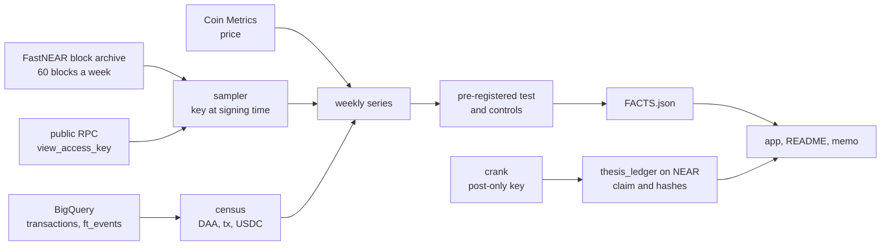
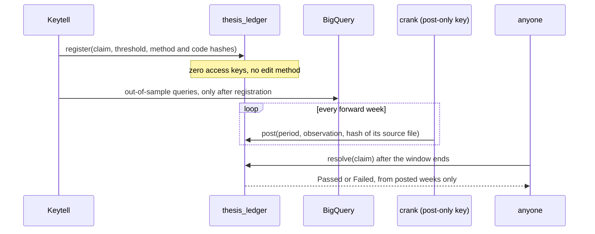

<p align="center">
  
</p>

<h1 align="center">Keytell</h1>

<p align="center">
  <b>On NEAR, do transactions signed by function-call keys show real usage before daily active accounts or price do?</b><br>
  Pre-registered on NEAR before the test data existed. Rebuild every number with one command.
</p>

<p align="center">
  <a href="{{app.url}}"><b>Live app</b></a> &nbsp;·&nbsp;
  <a href="{{app.url}}/evidence"><b>Evidence</b></a> &nbsp;·&nbsp;
  <a href="{{app.url}}/against"><b>Against</b></a> &nbsp;·&nbsp;
  <a href="{{app.url}}/ledger"><b>Ledger</b></a> &nbsp;·&nbsp;
  <a href="{{app.url}}/proof"><b>Proof from chain</b></a> &nbsp;·&nbsp;
  Video: linked at submission
</p>

<p align="center">
  <a href="{{repo.url}}/actions/workflows/ci.yml"></a>
  <a href="{{repo.url}}/actions/workflows/live.yml"></a>
  
</p>

<p align="center"></p>

> **{{backtest.headline}}.** {{backtest.plain}}
>
> Over {{backtest.oos_weeks_scored}} weeks the test had never seen, adding function-call activity to a baseline forecast of weekly USDC volume made it **{{backtest.oos_gain.fc_signed_tx|effect}}**. Daily active accounts made it {{backtest.oos_gain.daa|effect}}, price {{backtest.oos_gain.price|effect}}. The rule, written on chain first, needed function-call activity to beat both. {{sentences.rule_outcome}} A twelve-week forward test of the same claim is open on chain now and resolves without us.

## At a glance

| | |
|---|---|
| **Who it is for** | A research analyst who has to tell an investment committee whether NEAR usage is real or bots and airdrop farmers |
| **What it does** | Reads which kind of key signed each sampled mainnet transaction, tests whether function-call-signed activity forecasts USDC volume better than daily active accounts or price, publishes the case against with the same weight, and exports a memo the analyst signs |
| **Why NEAR** | Only NEAR has protocol-level function-call keys: a key bound to one contract that cannot move NEAR. Which kind of key signed is public state, for every transaction, at every block |
| **Verdict from chain** | Backtest: **{{backtest.headline}}** over {{backtest.oos_weeks_scored}} out-of-sample weeks. Forward claim `{{claim.id}}`: **{{claim.status_at_last_crank}}**, {{claim.forward_weeks}} weeks from {{windows.forward_start}} |
| **Headline result** | Against DAA, mean squared-error difference {{backtest.vs_daa.mean_sq_error_difference}} (95% interval {{backtest.vs_daa.ci95.0}} to {{backtest.vs_daa.ci95.1}}); against price {{backtest.vs_price.mean_sq_error_difference}} ({{backtest.vs_price.ci95.0}} to {{backtest.vs_price.ci95.1}}). Passing needed both intervals below zero |
| **What we found instead** | Signing moved from app-held function-call keys to relayed meta transactions: {{key_mix_by_year.0.fc|pct}} of transactions were signed directly by a function-call key in {{key_mix_by_year.0.year}}, {{key_mix_by_year.3.fc|pct}} in {{key_mix_by_year.3.year}}, while relayed meta transactions rose to {{key_mix_by_year.3.meta|pct}} |
| **Track** | Investment Thesis (`thesis`) |
| **Built with** | near-sdk 5.29 · near-workspaces · cargo-near reproducible build · NEP-297 · NEP-330 · NEP-366 · NEP-413 · near-connect · BigQuery `crypto_near_mainnet_us` · FastNEAR · Next.js 16 · d3 |

### See it on chain

| What happens | Transaction |
|---|---|
| The claim, its pass rule and the SHA-256 of the method and every query are written to the ledger, before any out-of-sample query | [registered]({{claim.registration_tx|explorer}}) at {{claim.registered_at}}; first out-of-sample query {{first_oos_query_at}} |
| The ledger is deployed and initialised in one transaction | [deployed]({{deployment.txs.deploy_and_init|explorer}}) |
| Its only key is deleted: nobody can upgrade it or edit a claim, including us | [sealed]({{deployment.txs.seal_ledger|explorer}}); access keys now **{{deployment.ledger_access_keys}}** |
| The crank receives a function-call key that can call `post` and nothing else | [key added]({{deployment.txs.crank_fc_key|explorer}}) |
| A threshold edit is attempted on a twin ledger: no such method exists | [refused, `MethodNotFound`]({{break_campaign.rows.4.tx|explorer}}) |
| Resolve | opens when the forward window ends; [/ledger]({{app.url}}/ledger) counts down, and anyone may call it |

All {{break_campaign.refusals}} attempts of the break campaign are listed under [What it will not do](#what-it-will-not-do).

---

## Monday 07:40

Tolu Adeyemi, a research analyst at a crypto fund in Lagos, has twenty minutes before the investment committee. The partner asks: *"Is anyone actually using NEAR, or is it bots and airdrop farmers?"* Every dashboard Tolu can open shows daily active accounts and price. Both are cheap to fake: one script makes a thousand accounts, one post moves price. Today Tolu screenshots a DAA chart, says "activity is up", and the committee sizes the position on conviction.

| What is true | Source |
|---|---|
| NEAR records which kind of key signed every transaction | [docs.near.org, access keys](https://docs.near.org/protocol/accounts-contracts/access-keys) |
| "`Function Call Keys` are meant to be shared with applications" | same page |
| Function-call keys "do not allow to attach NEAR tokens to the call" | same page |

**The insight.** A thousand fake accounts cost a script. A function-call key costs an app: it is issued by an account to one contract, and it only exists because someone built something that a user let act for them. If usage is real, those small keys should move before account counts and price do. Keytell turns that hunch into a claim that can fail, fixes it on chain before the data, and lets the data answer.

With Keytell, Tolu opens one page: the claim as it was written before the test, the evidence for, the evidence against, the SQL behind every chart, a lookup that classifies any account, and a memo to sign. Keytell never says buy. The NEP-413 signature on the memo is Tolu's attestation that the evidence against was read. *Tolu is an illustrative analyst; the data, the chain and the verdict are real.*

**Our stake, stated plainly.** The builder, Kinnoski, ships on NEAR: Berthright's crank signs with function-call keys, the very signal this thesis counts. We wanted the claim to hold. Writing it to chain before the data is what kept that wish out of the result.

---

## The claim

> {{claim.statement}}

Registered at {{claim.registered_at}} in `{{claim.ledger}}` ([transaction]({{claim.registration_tx|explorer}})). Method hash `{{claim.method_sha256|short}}...` ([docs/METHOD.md](docs/METHOD.md)); code manifest hash `{{claim.sql_sha256|short}}...` ([docs/CODE_MANIFEST.sha256](docs/CODE_MANIFEST.sha256), seventeen SQL, sampler and analysis files); data commit `{{claim.data_commit|short}}`. Both hashes still match the repository: method {{claim.method_sha256_matches_repo|bool}}, manifest {{claim.sql_sha256_matches_repo|bool}}. `make verify` and [/proof]({{app.url}}/proof) check this against the chain every time they run.

**The pass rule, as registered:** each signal enters an AR(2) forecast of weekly USDC volume at the lag (1 to 8 weeks) chosen on in-sample weeks only ({{windows.in_sample.0}} to {{windows.in_sample.1}}); expanding-window one-step forecasts are scored out of sample ({{windows.out_of_sample.0}} to {{windows.out_of_sample.1}}). The claim passes only if function-call-signed activity has a larger out-of-sample gain than both DAA and price **and** both moving-block bootstrap intervals of the error difference sit below zero.

## The evidence for

- {{sentences.verdict}}
- {{sentences.latest}}
- {{sentences.sample_check}}
- Best in-sample lags: function-call-signed {{backtest.best_in_sample_lag.fc_signed_tx}} weeks, DAA {{backtest.best_in_sample_lag.daa}}, price {{backtest.best_in_sample_lag.price}}. Only transaction count lowered the out-of-sample error at all ({{backtest.oos_gain.tx_count|signed}}).

## The evidence against

We lead with it as hard as with the case for.

- {{sentences.placebo}}
- {{sentences.concentration}}
- {{sentences.wild_set}}
- {{sentences.directions}}
- {{sentences.controls}}
- Largest weekly share of keys nobody could read: {{data.max_unknown_share|pct}}. Weeks above 5 percent in the scored window: {{data.weeks_unknown_over_5pct|list}}.

| Control rerun (registered before the test) | Function-call gain | DAA gain | Price gain | Weeks | Pass rule |
|---|---|---|---|---|---|
{{#each controls.rows}}
| {{.label}} | {{.headline_gain|signed}} | {{.daa_gain|signed}} | {{.price_gain|signed}} | {{.weeks}} | {{.would_pass|pass}} |
{{/each}}

## What we found instead

<p align="center"></p>

| Year | Weeks sampled | Transactions classified | Function-call key | Relayed meta transaction | Implicit account | Full-access key |
|---|---|---|---|---|---|---|
{{#each key_mix_by_year}}
| {{.year}} | {{.weeks}} | {{.txs|int}} | {{.fc|pct}} | {{.meta|pct}} | {{.implicit|pct}} | {{.full|pct}} |
{{/each}}

The classic pattern, where an app holds a scoped key for its user and signs on its own, faded. NEP-366 meta transactions took its place: a relayer pays the gas and the user's key signs the inner action. The function-call scopes that remain are concentrated: `{{concentration.top_scopes.0.scope}}` alone carries {{concentration.top_scopes.0.share_of_fc|pct}} of sampled function-call transactions. The one control that would pass counts relayed transactions as function-call activity. It was picked after the fact, so it is a hypothesis for the next pre-registration, not a result. Query and tables: [docs/FINDINGS.md](docs/FINDINGS.md).

## What would change this conclusion

- The forward claim succeeding on chain: at least half of the {{claim.forward_weeks}} forward weeks won. That is new evidence, not a rerun of old weeks.
- A new claim, registered before its data, that holds out of sample. A control picked after the fact does not count.
- The USDC census proving wrong or incomplete in a way that changes the out-of-sample errors.

---

## How it works

<table>
<tr>
<td width="50%"><b>1 · Read the key behind each signature.</b><br>Sixty seeded random blocks a week from the FastNEAR archive, then two hundred seeded random transactions. Each signing key is read with <code>view_access_key</code>, now or at the block before signing, and classified: function-call, full access, implicit account, or a relayed meta transaction's inner signer.</td>
<td width="50%"><b>2 · Count the chain in full.</b><br>BigQuery's public NEAR dataset gives weekly transactions, daily active accounts and USDC transfer volume. Every query carries its purpose, tables, dates and dry-run bytes, and refuses to run above a scan cap.</td>
</tr>
<tr>
<td><b>3 · Fix the test before the data.</b><br>The method, the comparator and the hash of every query and analysis file go to <code>thesis_ledger</code>, a keyless contract with no edit method. Only then do the out-of-sample queries run.</td>
<td><b>4 · Publish both sides, and keep watching.</b><br>The registered test and every control write <code>FACTS.json</code>; the app, this README and the memo read only from it. A crank posts each forward week with a key that can call <code>post</code> and nothing else.</td>
</tr>
</table>





## Why only NEAR

- **Access key types.** A function-call key is bound to one receiver, optional methods and a gas allowance, and cannot attach NEAR. Apps hold these keys for users. Every signature's key kind is public and can be read at any block, which is what makes the signal hard to fake.
- **Meta transactions.** NEP-366 delegate actions separate the relayer's signature from the user's. Keytell counts the user's inner signature, so a relayer carrying thousands of users does not read as one account.
- **Implicit accounts.** A 64-hex account signs with the key its name derives from; Keytell recognises it instead of guessing.
- **Names, not hashes.** `relay.tg`, `aurora` and `intents.near` are readable accounts, so the concentration brief can say which apps carry the signal, and `/keys` can classify any of them. {{sentences.hos}}

---

## What it will not do

Each attempt below is a real testnet transaction against a twin ledger running the same code hash as the real one; the contract's 21 unit tests, a 10,000-case property test and two sandbox tests pin the same rules.

| Attempt | Signer | Result, as designed | Transaction |
|---|---|---|---|
{{#each break_campaign.rows}}
| {{.name}} | `{{.signer}}` | {{.result}} | {{.tx|txlink}} |
{{/each}}

## Who holds which key

| Account | Keys | Can | Cannot |
|---|---|---|---|
| `{{claim.ledger}}` | **{{deployment.ledger_access_keys}}** (deleted after init) | run its own rules | be upgraded, edited or drained by anyone, including us |
| `{{deployment.crank}}` | one function-call key, `post` only, 0.25 NEAR gas allowance | post one forward week, once, after it ends | register, resolve early, backdate, or touch a claim's terms |
| `{{deployment.publisher}}` | full access | register a new claim before its window opens | change a registered claim (no such method exists) |
| the app's server | **none** | read public RPC and BigQuery outputs | sign anything for anyone |
| an analyst's wallet | their own | sign the memo attestation (NEP-413, no transaction, no fee) | nothing on Keytell's contracts |

---

## Measured

Out-of-sample gain is 1 minus the model's squared forecast error over the AR(2) baseline's: positive means smaller errors, negative means adding the signal made forecasts worse.

| Measure | Value | Source |
|---|---|---|
| Out-of-sample gain, function-call-signed | {{backtest.oos_gain.fc_signed_tx|signed}} | data/out/results.json |
| Out-of-sample gain, DAA | {{backtest.oos_gain.daa|signed}} | same |
| Out-of-sample gain, price | {{backtest.oos_gain.price|signed}} | same |
| Out-of-sample gain, function-call share | {{backtest.oos_gain.fc_share|signed}} | same |
| Out-of-sample gain, transaction count | {{backtest.oos_gain.tx_count|signed}} | same |
| Hits, false alarms, misses (function-call) | {{backtest.directions.fc_signed_tx.hits}}, {{backtest.directions.fc_signed_tx.false_alarms}}, {{backtest.directions.fc_signed_tx.misses}} | data/out/directions.csv |
| Hits, false alarms, misses (DAA) | {{backtest.directions.daa.hits}}, {{backtest.directions.daa.false_alarms}}, {{backtest.directions.daa.misses}} | same |
| Timing placebos beaten | {{controls.placebo.share_beaten|pct0}} of {{controls.placebo.reps}} (the bar is 95%) | data/out/placebo.csv |
| Weeks flagged as possible bots or farming | {{controls.episodes_flagged}} | data/out/episodes.csv |
| Weeks sampled | {{data.weeks_sampled}} ({{data.first_week}} to {{data.last_week}}) | data/raw/sample |
| Blocks sampled, transactions classified | {{data.blocks_sampled|int}}, {{data.transactions_classified|int}} | same |
| Keys read at the block before signing (archival) | {{data.archival_lookups|int}} | same |
| Sample against census, median week | within {{data.sample_vs_census_tx_median_abs_pct_error|pct}} | data/out/weekly.csv |
| Census through | {{data.census_last_day}} | data/out/bq_runs.jsonl |
| Cost per census rebuild | {{cost.rebuild_gb}} GB, about ${{cost.rebuild_usd_at_on_demand_price}} at the on-demand price (inside the free monthly terabyte) | same |
| Cost per forward observation | {{cost.per_observation_tgas}} Tgas, {{cost.per_observation_near}} NEAR; the whole twelve-week claim about {{cost.forward_claim_near}} NEAR | [measured]({{cost.per_observation_tx|explorer}}) |
| Live app, end to end | {{e2e.live.passed}} of {{e2e.live.total}} checks on {{e2e.live.base}}, including the wallet selector and forged-signature refusals | e2e/live-report.json |
| Layout and accessibility | {{e2e.layout.clean}} of {{e2e.layout.total}} views clean ({{e2e.layout.routes}} routes × {{e2e.layout.viewports}} viewports): no horizontal scroll, no overlap, tap targets of 44 px, axe WCAG 2.2 AA, no console errors | e2e/layout-report.json |

## Try it in two minutes

1. Open **[/keys]({{app.url}}/keys)** and type `aurora` or `relay.tg`. See its keys marked function-call or full access, and its recent transactions classified by the key that signed them. No wallet.
2. Open **[/proof]({{app.url}}/proof)**. Every check runs in your browser against NEAR testnet and against files your browser hashes itself.
3. From a clean clone, with no keys:

```bash
git clone {{repo.url}} && cd keytell && make setup && make verify
```

<table>
<tr>
<td></td>
<td></td>
</tr>
<tr>
<td></td>
<td></td>
</tr>
</table>

## Judging criteria map

| Criterion | Where to look |
|---|---|
| **Technical implementation** | a keyless sampler that classifies keys at signing time on archival RPC; census SQL tested against the TypeScript classifier on fixtures in BigQuery; `thesis_ledger` with 21 unit tests, a 10,000-case property test, two sandbox tests and a 16-attempt break campaign; a reproducible build whose hash matches chain; `make verify` with a tamper check |
| **Design** | the Assay system ([docs/DESIGN.md](docs/DESIGN.md)); the Key Wall is the data; every brief answers one question in one generated sentence |
| **Impact** | an analyst's real question answered with a claim that could not be tuned, the case against at full weight, and a memo the analyst signs |
| **Originality** | a NEAR-only signal (the key kind behind each signature), pre-registered on NEAR, observed on chain by the very kind of key it counts; a falsified thesis published as the headline |
| **Sustainability** | a weekly crank and six-hourly live checks; every number rebuilds from public data; the forward claim resolves without us |

## Live, substituted, designed

| Piece | State |
|---|---|
| Ledger, claim, crank key, proof checks | **live** on NEAR testnet, keyless; code hash equals the reproducible build |
| The data | **live** NEAR mainnet: FastNEAR block archive, public RPC (current and archival), BigQuery public dataset |
| `/keys` | **live** mainnet RPC; recent transactions from FastNEAR's transaction API, because NearBlocks rate-limited this build |
| Price | Coin Metrics Community API, because CoinGecko's public API covers 365 days only |
| Memo signature | **live** NEP-413 through near-connect on mainnet wallets; the server checks the signature and that the key is a full-access key of the account |
| Degraded states | designed and labelled: `KEYTELL_FAULT=stale_bq`, `intents_down`, `rpc_down` |

## Limits

- The key mix is a sample: {{data.transactions_classified|int}} transactions over {{data.weeks_sampled}} weeks, with intervals. The full ADD_KEY ledger would scan about 20 TB.
- USDC volume before 2023-10-16 is not in the census (USDC.e logged no NEP-141 events until 2023-10-11), so earlier weeks are shown, not scored.
- The contract resolves on the observations the crank posts. Trust in those numbers comes from `make verify`, which recomputes each from public data and compares hashes, not from the contract.
- Retention and NEAR Intents volume are not computed: the first is above the scan budget, the second needs a partner key this build did not have.
- The ledger runs on testnet; the data is mainnet.

## Disclosures

Built with an AI coding agent under the author's direction. Libraries: near-sdk, near-workspaces, near-api-js, @hot-labs/near-connect, Next.js, React, Tailwind, motion, lenis, d3, lucide-react, proptest, numpy, pandas, scipy, statsmodels. Data: BigQuery public dataset terms; Coin Metrics Community Data (attribution); FastNEAR public endpoints; CoinGecko was evaluated and not used. Tolu Adeyemi is an illustrative persona. Nothing here is investment advice. **Other project by the same builder in this hackathon: Berthright (NFTs That Do Something), github.com/0xkinno/berthright.** The two are independent.

## Run it

```bash
make setup && make verify
```

```bash
make test
```

```bash
make sample FROM=2025-01-06 TO=2025-01-06
```

```bash
cd app && npm ci && npx next dev
```

Testnet accounts, code hashes and transactions: `deployments/testnet.json`. The deployed app: `deployments/app.json`.

## Repository map

```
contracts/thesis_ledger   the pre-registration ledger (Rust, near-sdk 5.29): unit, property and sandbox tests
scripts/                  sampler, classifier, facts, verify, register, crank, break campaign, README renderer
sql/                      census queries, each with purpose, tables, dates and dry-run bytes in its header
analysis/                 weekly series, the registered test, controls, findings, memo
data/                     committed inputs and outputs, registration, break campaign
app/                      the Next.js site and its API routes
e2e/                      judge run, live suite, layout and accessibility, NEP-413 check, screenshots
docs/                     METHOD, FACTS, FINDINGS, EVIDENCE, THESIS, MOMENT, RISK, DESIGN, SDK_SURFACE, PROOF_PLAN
```

MIT licence · [METHOD](docs/METHOD.md) · [FINDINGS](docs/FINDINGS.md) · [EVIDENCE](docs/EVIDENCE.md) · [RISK](docs/RISK.md) · [PROGRESS](PROGRESS.md)
